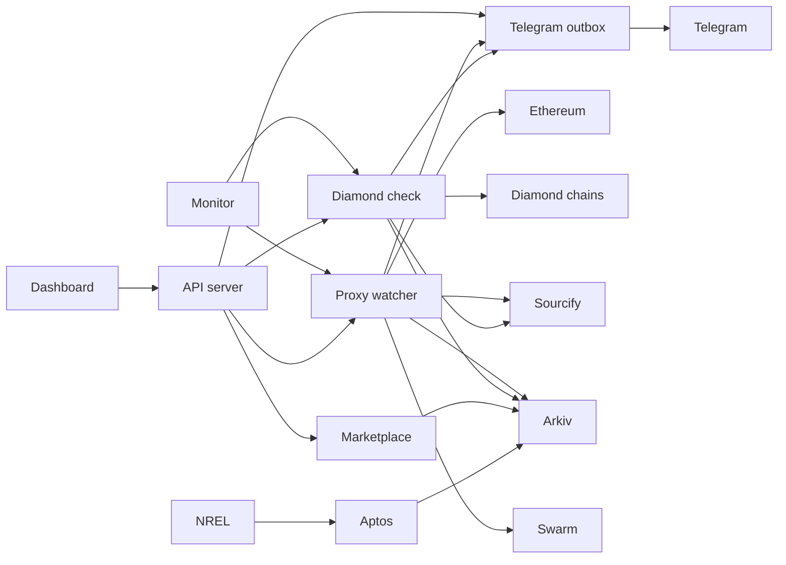

# Tracer

A public record of contract changes. Tracer watches Ethereum proxies and cross chain diamonds, asks Sourcify whether the new code is verified, and writes the result to Arkiv. A swap to unverified code is the critical signal. The same record sells attested real world data, and a change can reach you in the browser and on Telegram.

Built for ETHweek, Build on Arkiv.

## Architecture



The dashboard reads Arkiv. Checks and simulations go through the API, which is the only writer. The monitor repeats those checks and sends Telegram only when the result changes. Swarm stores the evidence bundle. Aethera readings start at NREL, land on Aptos with a transaction proof, and are reattested on Arkiv so they can be queried and sold.

## What it watches

The watcher reads each proxy implementation slot. It covers EIP 1967 and the legacy OpenZeppelin slot, so USDC is included. On a change it asks Sourcify and writes an `upgrade.alert` owned by the watcher wallet. Alerts expire in about 30 days. The proxy `upgrade.state` row is updated in place.

Severity:

* **critical**: the new code is unverified
* **warning**: the new code is verified
* **info**: the first observation of that proxy

The watchlist is USDC, Aave V3 Pool, Compound III cUSDCv3, and Compound III cWETHv3.

## Diamond check

An EIP 2535 diamond has no single implementation. Each function selector points at a facet, and the same diamond often runs on many chains. Tracer reads `facets()` and `owner()` on each chain, hashes the deployed code, and compares that chain with its own pinned manifest.

LI.FI is the pinned diamond. A new or changed facet whose code Sourcify cannot verify, or a new owner, marks that chain critical. A facet moved to a new address with the same code is not a change. A code change at the same address is, because the comparison stores the code hash.

```bash
npm run diamond:pin -- lifi
npm run diamond:check -- lifi
npm run diamond:check -- lifi --simulate 137
```

## Marketplace

Aethera publishes NREL irradiance for solar sites on Aptos. Each reading keeps that transaction as its proof. Tracer attests the readings on Arkiv (`aethera.solar`) and sells the feed. The price is a Data Power Index: freshness, coverage, depth, integrity, and rarity. Verifiable readings earn a premium.

Other listings use the same provider shape: research intelligence, the admin risk feed, a DePIN registry, and a rug risk score.

```bash
npm run seed:aethera
npm run seed:market
```

## Notifications

Enable alerts in the header. The page polls Arkiv for critical upgrades and raises a browser notification when a new one appears. Alerts that already exist when you turn it on stay quiet.

The API also sends Telegram. A message is queued as soon as a proxy or diamond is classified, before the Arkiv write. The same implementation is not sent twice. A return to the pinned manifest sends a recovery note. Simulations are labeled and do not clear a live finding.

```bash
npm run dev:all
```

With `MONITOR_ENABLED=true`, one server process checks proxies and diamonds about 60 seconds after the previous cycle finishes. Run only one of `npm run server` and `npm run monitor`.

## Try it

```bash
npm install
cp .env.example .env
npm run query:alerts
npm run dev
```

Watcher wallet on Rabdi:

```
0x329753C220B38b8901fB38a247cdcD77f6AC8529
```

Reads are limited to entities this wallet owns.

```bash
npm run watch
npm run watch -- --simulate USDC
npm run watch -- --reset
```

## Arkiv, in short

Filtering uses indexed severity, verification, proxy, and block. Ownership limits the feed to the watcher wallet. Expiry keeps a 30 day window. State is patched and extended instead of appended.

## Layout

| Path | Role |
| --- | --- |
| `src/watch.ts` | Read slots, ask Sourcify, write alerts |
| `src/lib/diamond/` | Loupe reader, manifest diff, cross chain check |
| `src/lib/notifications/` | Telegram outbox and change detection |
| `server/monitor.ts` | Repeat checks inside the API process |
| `src/lib/marketplace/` | Listings, purchases, and pricing |
| `arkiv/` | Schema notes and how Arkiv is used |

## License

MIT. See [LICENSE](./LICENSE).
